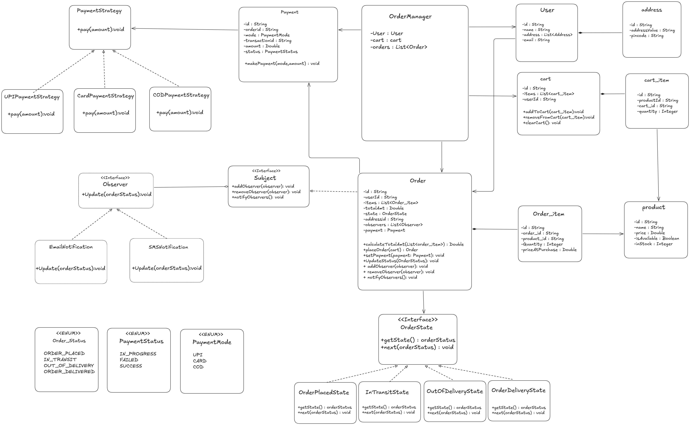

# E-Commerce Low-Level Design (LLD)

This document covers the complete Low-Level Design (LLD) for an E-Commerce system, including requirements, class design, database design, and API design.

## 📋 Requirements

1. Users can visit the site and create an account.
2. Users can save multiple home addresses.
3. Users can browse and find products (includes search algorithms).
4. Users can add products to their cart.
5. Users can place an order -> items in the cart are to be delivered to the selected address.
6. A payment system allows various payment strategies to be used.
7. Upon successful order, the cart is emptied again.

## 🏗️ Classes & Entities

1. User
2. Address
3. Product
4. Cart
5. Order
6. PaymentStatus (Enum)
7. PaymentStrategy (Strategy Pattern)
8. OrderManager (Singleton Pattern)

## 🗄️ Database Design

### Tables

1. `User`
2. `Address`
3. `Product`
4. `Cart`
5. `Cart_Items`
6. `Order`
7. `Order_Items`
8. `Payment`

### Tables and Columns

| Table | Columns |
|-------|---------|
| **User** | `id`, `name`, `email` |
| **Address** | `id`, `user_id` (FK), `address`, `pincode` |
| **Product** | `id`, `name`, `stock`, `isAvailable`, `price` |
| **Cart** | `id`, `user_id` (FK) |
| **Cart_Items** | `id`, `cart_id` (FK), `product_id` (FK), `quantity` |
| **Order** | `id`, `user_id` (FK), `address_id` (FK), `status`, `totalAmount` |
| **Order_Items**| `id`, `order_id` (FK), `product_id` (FK), `quantity`, `price` |
| **Payment** | `id`, `order_id` (FK), `status`, `mode`, `totalAmount` |

### Relationships

- One **User** can have many **Addresses** → `1:N`
- One **User** can have many **Orders** → `1:N`
- One **User** has exactly one **Cart** → `1:1`
- One **Cart** can have many **Cart_Items** → `1:N`
- One **Cart_Item** has exactly one **Product** → `1:1`
- One **Order** can have many **Order_Items** → `1:N`
- One **Order** has exactly one **Payment** → `1:1`
- One **Order** has exactly one **Address** → `1:1`
- One **Order_Item** has exactly one **Product** → `1:1`

## 📊 UML Diagram

*You can view and modify the original diagram here: [Ecommerce.excalidraw](./Ecommerce.excalidraw)*

This is the complete UML Diagram for the E-Commerce System.

## 🧩 Design Patterns Implemented

1. **State Design Pattern**
    - Implemented for tracking the state of each order.
2. **Strategy Design Pattern**
    - Implemented for plugging multiple payment methods.
3. **Observer Design Pattern**
    - Implemented for updating the user about the order status with notifications.

## 🔌 API Design

| API Name | Method | Endpoint | Request Body |
|----------|--------|----------|--------------|
| **Get All Products** | `GET` | `/products` | - |
| **Get Product Detail** | `GET` | `/products/{id}` | - |
| **Add to Cart** | `POST` | `/cart/items` | `productid`, `quantity` |
| **Remove from Cart** | `DELETE`| `/cart/items/{productId}` | - |
| **Checkout** | `POST` | `/buy` | `address` |
| **Get Cart** | `GET` | `/cart/{userId}` | - |
| **Pay** | `POST` | `/completePayment` | `orderid`, `paymentMethod` |
| **Track Order** | `GET` | `/order/track/{orderid}` | - |