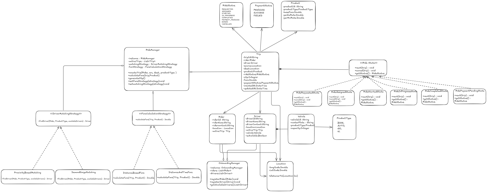

# 🚖 Ride Booking Application (Low Level Design)

A comprehensive Low-Level Design (LLD) for a Ride Booking Application (like Uber/Ola), designed using Object-Oriented principles and modular design patterns.

---

## 📋 Requirements

### 1. Functional Requirements
* **User Onboarding:** Riders and drivers can register on the platform.
* **Driver Onboarding:** Drivers can register their vehicles, mapping the vehicle to a Product type (e.g., Bike, Auto, GO, XL).
* **Booking a Ride:** 
  * Rider inputs source and destination locations.
  * System displays available ride products along with estimated fares.
  * Rider selects a product and confirms the booking.
* **Matching & Assignment:** The system efficiently assigns an available driver with a matching vehicle type to the rider.
* **Trip Lifecycle:**
  * After assignment, the driver and rider can view each other's live locations.
  * Rider provides a secure OTP to the driver to start the trip.
  * Driver ends the trip upon reaching the destination.
  * Rider makes the payment, and the trip is closed out.
* **Constraints:** A rider cannot be assigned multiple drivers simultaneously, and vice versa.

### 2. Non-Functional Requirements (Design Constraints)
* **Extensibility:** New riders and drivers should be added without modifying core logic (Open-Closed Principle).
* **Pluggable Strategies:** 
  * **Driver Matching:** Easy to plug in new algorithms (e.g., nearest driver vs. highest rated driver).
  * **Fare Calculation:** Easy to plug in dynamic pricing models (e.g., surge pricing based on time/weather).
* **Separation of Concerns:** Distinct components for User/Driver Onboarding, Pricing, Driver Matching, and Trip Lifecycle management (Single Responsibility Principle).
* **State Management:** Strict central control over trip state transitions to prevent invalid states
### 3. Future Scope / Integrations
* Real-time GPS and Map integrations (e.g., Google Maps API).
* Payment Gateway integrations (Stripe, Razorpay) for transaction processing.
* Real-time Push Notifications via WebSockets or Firebase.

---

## 🏗️ Core Entities and Components

### Enums
* `ProductType`: Defines the category of ride.
* `RideStatus`: Tracks the lifecycle of a ride.
* `PaymentStatus`: Tracks payment status.

### Core Models
* `Rider` & `Driver`: Represent the users in the system.
* `Location`: Encapsulates latitude, longitude, and address details.
* `Vehicle`: Represent the car details (License plate, Model).
* `Product`: Represents the category a vehicle falls under.
* `Trip`: The central entity binding a Rider, Driver, Vehicle, Route, Status, and Fare.

### Core Managers (Services)
* `OnboardingManager`: Handles registration and verification of users and drivers.
* `RideManager`: Orchestrates the entire flow from ride request to completion.

---

## 🎨 Design Patterns Used

This solution leverages several GoF Design Patterns to ensure a robust and scalable architecture:

1. **Strategy Pattern:** 
   * **`DriverMatchingStrategy`:** Allows dynamic switching between different algorithms to find a driver (e.g., Proximity-based, Rating-based).
   * **`FareCalculationStrategy`:** Enables different pricing models (e.g., Base pricing, Surge pricing, Distance-time based).
2. **State Pattern:** 
   * Manages the complex state transitions of a `Trip`. Ensures that actions are only performed when valid.
3. **Factory Pattern:**
   * Used to instantiate specific strategy implementations dynamically based on input (e.g., `FareStrategyFactory`).
4. **Singleton Pattern:**
   * Applied to stateless Manager classes (`OnboardingManager`, `RideManager`) to prevent unnecessary memory allocations and manage shared resources.

---

## 📐 UML Diagram

Here is the structural view of the system demonstrating the relationships and behaviors:

*(Note: The `RideBooking.excalidraw` file is included in this repository. You can open and edit it using [Excalidraw](https://excalidraw.com/).)*