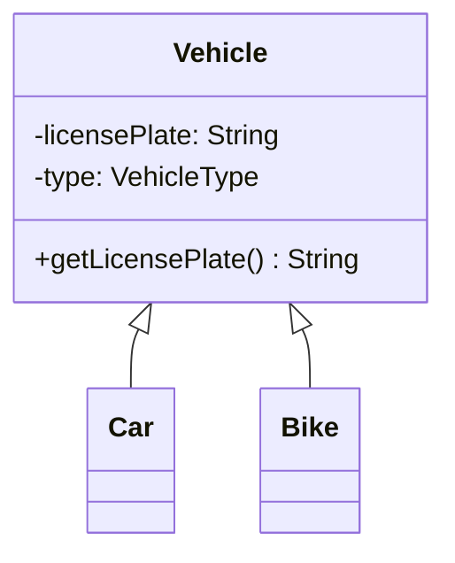

# 05 — UML and Entity Mapping

> **Purpose of this file:** Understand what UML is, why it matters in LLD, which diagrams to use when, and how to map real-world problems into entities, attributes, and relationships before writing a single line of code.

---

## Table of Contents

1. [Why UML Exists](#1-why-uml-exists)
2. [The Two UML Diagrams You Must Know for LLD](#2-the-two-uml-diagrams-you-must-know-for-lld)
3. [Class Diagram — Deep Dive](#3-class-diagram--deep-dive)
4. [Sequence Diagram — Deep Dive](#4-sequence-diagram--deep-dive)
5. [Entity Mapping — How to Think About It](#5-entity-mapping--how-to-think-about-it)
6. [Step-by-Step: Problem → Entities → UML](#6-step-by-step-problem--entities--uml)
7. [Worked Example: Parking Lot](#7-worked-example-parking-lot)
8. [Worked Example: Library Management System](#8-worked-example-library-management-system)
9. [Relationships Cheat Sheet](#9-relationships-cheat-sheet)
10. [Common Mistakes](#10-common-mistakes)
11. [Tools to Draw UML](#11-tools-to-draw-uml)
12. [How to Structure This in GitHub](#12-how-to-structure-this-in-github)
13. [Revision Checklist](#13-revision-checklist)

---

## 1. Why UML Exists

When you solve an LLD problem, you need a shared language to communicate your design — with interviewers, teammates, and future-you.

**UML (Unified Modeling Language)** is that language. It is a standardised way to draw software systems as diagrams.

You don't memorise UML for its own sake. You use it because:

- It forces you to think about structure *before* you code
- It makes implicit design decisions explicit (who owns what? who calls whom?)
- It is the expected output in LLD interviews
- When you revisit a problem months later, a good diagram tells you everything in 30 seconds

Think of UML as a blueprint. An architect draws blueprints before construction starts — not because blueprints are the end goal, but because they catch problems early.

---

## 2. The Two UML Diagrams You Must Know for LLD

There are 14 types of UML diagrams. For LLD interviews and practice, you need exactly two:

| Diagram | Answers the question | When to draw it |
|---|---|---|
| **Class Diagram** | What are the entities and how are they related? | Always — first thing you draw |
| **Sequence Diagram** | How do objects talk to each other for a specific flow? | For key flows (e.g. book a ticket, process a payment) |

The other diagrams (use case, activity, state, component, etc.) are useful but secondary. Master these two first.

---

## 3. Class Diagram — Deep Dive

### What it represents

A class diagram shows:
- **Classes** (your entities — real-world things modelled as objects)
- **Attributes** (the data each class holds)
- **Methods** (the behaviour each class exposes)
- **Relationships** (how classes connect to each other)

### Syntax

```
┌─────────────────────────┐
│       ClassName         │   ← Class name (bold, centred)
├─────────────────────────┤
│ - privateAttribute: Type│   ← Attributes
│ + publicAttribute: Type │
│ # protectedAttr: Type   │
├─────────────────────────┤
│ + publicMethod(): Type  │   ← Methods
│ - privateMethod(): void │
└─────────────────────────┘
```

**Visibility symbols:**
- `+` public
- `-` private
- `#` protected
- `~` package/default

### Example class

```
┌──────────────────────────────┐
│           Vehicle            │
├──────────────────────────────┤
│ - licensePlate: String       │
│ - type: VehicleType (enum)   │
├──────────────────────────────┤
│ + getLicensePlate(): String  │
│ + getType(): VehicleType     │
└──────────────────────────────┘
```

### Relationship Types (this is the hard part — memorise this)

#### Association
Two classes know about each other. A Customer *has* an Address.

```
Customer ──────────── Address
```

#### Directed Association
One class uses the other, but not vice versa.

```
Order ──────────────> Customer
```
(An Order knows about the Customer. The Customer doesn't know about the Order.)

#### Aggregation ("has-a", but parts can exist independently)
A whole-part relationship where the part can exist without the whole.

```
Team ◇──────────────── Player
```
(A Team has Players. But Players exist even if the Team is disbanded.)
- Hollow diamond on the *whole* side
- Think: "Team has Players"

#### Composition ("contains-a", parts die with the whole)
A stronger whole-part relationship where the part *cannot* exist without the whole.

```
House ◆──────────────── Room
```
(A Room cannot exist without a House. Delete the House, Rooms are gone.)
- Filled diamond on the *whole* side
- Think: "House contains Rooms"

#### Inheritance / Generalisation ("is-a")
A child class is a specialised version of a parent class.

```
Animal ◁────────────── Dog
```
(Dog *is an* Animal. Open arrowhead pointing to parent.)

#### Realisation / Implementation (class implements interface)
A class implements an interface.

```
«interface»
Payable ◁─ ─ ─ ─ ─ ─── CreditCard
```
(Dashed line with open arrowhead.)

#### Dependency ("uses temporarily")
One class depends on another briefly (e.g. as a method parameter).

```
BookingService ─ ─ ─ ─> PaymentGateway
```

### Multiplicity (cardinality)

Placed at both ends of a relationship line:

| Notation | Meaning |
|---|---|
| `1` | exactly one |
| `0..1` | zero or one |
| `*` | zero or more |
| `1..*` | one or more |
| `2..5` | between 2 and 5 |

Example:
```
Customer 1 ──────── 0..* Order
```
One Customer can have zero or many Orders. Each Order belongs to exactly one Customer.

---

## 4. Sequence Diagram — Deep Dive

### What it represents

A sequence diagram shows *how* objects interact over time for a specific use case. It is a timeline view.

Use it to model a single flow, for example:
- "User books a movie ticket"
- "ATM dispenses cash"
- "Rider requests an Uber"

### Syntax

```
      User          BookingService      SeatRepository       PaymentService
       |                  |                   |                    |
       |──book(showId)───>|                   |                    |
       |                  |──findSeats(id)───>|                    |
       |                  |<──[available]─────|                    |
       |                  |──lockSeat(seatId)>|                    |
       |                  |──processPayment()─────────────────────>|
       |                  |<──[success]────────────────────────────|
       |<──confirmation───|                   |                    |
       |                  |                   |                    |
```

Key elements:
- **Lifelines** — vertical dashed lines, one per participant (actor or object)
- **Activation bar** — thin rectangle on a lifeline showing when it is active
- **Synchronous message** — solid arrow `──>` (caller waits for response)
- **Return message** — dashed arrow `<──` (response back to caller)
- **Self-call** — arrow looping back to same lifeline

### When to draw a sequence diagram

Draw one for each non-trivial use case. For a Parking Lot problem you'd draw:
1. Vehicle enters and gets a ticket
2. Vehicle exits and pays

For an ATM:
1. Successful cash withdrawal
2. Insufficient funds failure flow

---

## 5. Entity Mapping — How to Think About It

**Entity mapping is the process of translating a problem statement into classes.**

This is the most important skill in LLD. Before you think about patterns or code, you need to know *what the things are*.

### The three questions to ask

For every problem, go through these three questions in order:

**Q1: What are the nouns?**
Every significant noun in the problem statement is a candidate entity (class).

**Q2: What does each entity *know*?**
These become attributes (fields).

**Q3: What does each entity *do*?**
These become methods (behaviour).

### A fourth question for relationships

**Q4: How do entities relate to each other?**
- Does A *own* B, or just *use* B? (Composition vs Association)
- Can B exist without A? (Composition vs Aggregation)
- Is A a type of B? (Inheritance)
- Does A depend on B only temporarily? (Dependency)

### Entity mapping template

For each entity you identify, fill this in:

```
Entity:      [Name]
Attributes:  [list of data it holds]
Methods:     [list of things it can do]
Relates to:  [other entities and relationship type]
```

### What makes a good entity vs a bad one

| Good entity | Bad entity |
|---|---|
| Represents a real-world thing or concept in the domain | Too vague ("Manager", "Handler", "Helper") |
| Has its own data and/or behaviour | Only holds data with no behaviour (could be a plain struct) |
| Has a clear, single responsibility | Does too many things |
| Other entities genuinely need to reference it | Never referenced by anything else |

---

## 6. Step-by-Step: Problem → Entities → UML

Use this process every time you approach a new LLD problem.

### Step 1: Read and restate the problem in one sentence

Forces you to understand the core domain.

### Step 2: Extract all nouns → candidate entities

Highlight nouns in the problem statement. Every noun is a *candidate* — you will filter later.

### Step 3: Filter — keep entities that have identity

Discard nouns that are just primitive attributes (e.g. "name", "price") or that are too vague.

### Step 4: For each entity, define attributes and methods

Keep attributes minimal — only what this system needs, not everything possible about a real-world thing.

### Step 5: Define relationships between entities

Go through every pair of entities and ask: do these two know about each other? Who owns whom?

### Step 6: Identify interfaces and abstract classes

Are there multiple things that share a contract but differ in behaviour? That's an interface. (e.g. `Vehicle` as an interface, `Car` and `Bike` as implementations.)

### Step 7: Draw the class diagram

Start with the core entities in the centre. Add supporting entities around them. Draw relationships last.

### Step 8: Draw sequence diagrams for key flows

Pick the 1–2 most important operations and trace the object interactions.

---

## 7. Worked Example: Parking Lot

### Problem statement

Design a parking lot system that can park vehicles (cars and bikes), issue tickets on entry, and process payment on exit.

### Step 1: Restate

A system to manage vehicle entry/exit and payment for a multi-floor parking lot.

### Step 2–3: Extract entities

| Noun | Keep? | Reason |
|---|---|---|
| ParkingLot | Yes | Top-level container |
| Floor | Yes | Has slots, grouped per floor |
| ParkingSlot | Yes | Core unit that vehicles occupy |
| Vehicle | Yes | What gets parked (abstract) |
| Car | Yes | Concrete vehicle type |
| Bike | Yes | Concrete vehicle type |
| Ticket | Yes | Issued on entry, used on exit |
| Payment | Yes | Processes fee calculation |
| EntryGate | Yes | Entry point |
| ExitGate | Yes | Exit point |
| name / licensePlate | No | Attribute, not entity |

### Step 4: Entity definitions

```
Entity:      ParkingLot
Attributes:  name, address, List<Floor> floors
Methods:     getAvailableSlot(vehicleType), park(vehicle), processExit(ticket)

Entity:      Floor
Attributes:  floorNumber, List<ParkingSlot> slots
Methods:     getAvailableSlot(vehicleType), hasAvailableSlot()

Entity:      ParkingSlot
Attributes:  slotId, slotType (COMPACT/LARGE/BIKE), isOccupied, Vehicle parkedVehicle
Methods:     assignVehicle(vehicle), removeVehicle(), isAvailable()

Entity:      Vehicle  [abstract]
Attributes:  licensePlate, VehicleType type
Methods:     getLicensePlate(), getType()

Entity:      Car / Bike  [extends Vehicle]
Attributes:  (inherits from Vehicle)
Methods:     (inherits from Vehicle)

Entity:      Ticket
Attributes:  ticketId, Vehicle vehicle, ParkingSlot slot, entryTime, exitTime, amountDue
Methods:     calculateFee(), markExit()

Entity:      Payment
Attributes:  paymentId, Ticket ticket, amount, paymentMode, status
Methods:     processPayment()
```

### Step 5: Relationships

```
ParkingLot  ◆──── 1..* Floor           (Composition — floors die with lot)
Floor       ◆──── 1..* ParkingSlot     (Composition — slots die with floor)
ParkingSlot ○──── 0..1 Vehicle         (Association — slot references vehicle when occupied)
Vehicle     ◁─────────── Car           (Inheritance)
Vehicle     ◁─────────── Bike          (Inheritance)
Ticket      ────────────> ParkingSlot  (Association)
Ticket      ────────────> Vehicle      (Association)
Payment     ────────────> Ticket       (Association)
```

### Class Diagram (text representation)

```
                    ┌─────────────────┐
                    │   ParkingLot    │
                    ├─────────────────┤
                    │ - name: String  │
                    │ - floors: List  │
                    ├─────────────────┤
                    │ + park()        │
                    │ + processExit() │
                    └────────┬────────┘
                             │ 1
                        (Composition)
                             │ 1..*
                    ┌────────▼────────┐
                    │     Floor       │
                    ├─────────────────┤
                    │ - floorNo: int  │
                    │ - slots: List   │
                    ├─────────────────┤
                    │ + getAvail()    │
                    └────────┬────────┘
                             │ 1
                        (Composition)
                             │ 1..*
              ┌──────────────▼──────────────┐
              │         ParkingSlot          │
              ├──────────────────────────────┤
              │ - slotId: String             │
              │ - slotType: SlotType         │
              │ - isOccupied: boolean        │
              ├──────────────────────────────┤
              │ + assignVehicle(v: Vehicle)  │
              │ + removeVehicle()            │
              └──────────────────────────────┘

     ┌──────────────────────────┐
     │       «abstract»         │
     │         Vehicle          │
     ├──────────────────────────┤
     │ - licensePlate: String   │
     │ - type: VehicleType      │
     └────────────┬─────────────┘
             ┌────┴────┐
             ▽         ▽
          ┌──────┐  ┌──────┐
          │  Car │  │ Bike │
          └──────┘  └──────┘

     ┌──────────────────────────┐
     │          Ticket          │
     ├──────────────────────────┤
     │ - ticketId: String       │
     │ - entryTime: DateTime    │
     │ - exitTime: DateTime     │
     │ - amountDue: double      │
     ├──────────────────────────┤
     │ + calculateFee(): double │
     │ + markExit()             │
     └──────────────────────────┘
```

### Sequence Diagram: Vehicle Entry

```
  Driver        EntryGate       ParkingLot        Floor         ParkingSlot      Ticket
    |                |               |               |               |               |
    |──enter(v)─────>|               |               |               |               |
    |                |──findSlot(v)─>|               |               |               |
    |                |               |──getSlot(v)──>|               |               |
    |                |               |               |──available?──>|               |
    |                |               |               |<──[yes]───────|               |
    |                |               |<──[slot]──────|               |               |
    |                |               |──────────────────assign(v)───>|               |
    |                |               |──createTicket()────────────────────────────── >|
    |                |<──[ticket]────|               |               |               |
    |<──ticket───────|               |               |               |               |
```

---

## 8. Worked Example: Library Management System

### Entities

| Entity | Key Attributes | Key Methods |
|---|---|---|
| Library | name, address, List\<Book\> | searchBook(), addBook() |
| Book | ISBN, title, author, List\<BookItem\> | isAvailable() |
| BookItem | barcode, isCheckedOut, dueDate | checkout(), returnBook() |
| Member | memberId, name, List\<Loan\> | borrowBook(), returnBook() |
| Loan | loanId, BookItem, Member, issueDate, dueDate | isOverdue(), calculateFine() |
| Librarian | staffId (extends Member or Person) | issueBook(), receivReturn() |
| Catalog | | search(title), search(author), search(ISBN) |

### Key relationship decisions

- `Book` vs `BookItem`: A Book is the *concept* (Harry Potter). A BookItem is a *physical copy* on the shelf. One Book has many BookItems. This is a common LLD distinction — learn it.
- `Member` has `Loan` records, not `Book` directly — this gives you history, due dates, and fine calculation.
- `Catalog` is a service class that wraps search logic. It is not a real-world thing — it is a design decision to keep search concerns separate from `Library`.

### Relationship types

```
Library   ◆──── 1..* Book          (Composition)
Book      ◆──── 1..* BookItem      (Composition)
Member    ────── 0..* Loan         (Association)
Loan      ────────────> BookItem   (Association)
Librarian ◁────────────── Member   (Inheritance, or separate Person hierarchy)
```

---

## 9. Relationships Cheat Sheet

| If you think... | Use this | Symbol |
|---|---|---|
| A *is a type of* B | Inheritance | `◁──────` open arrowhead |
| A *implements* interface B | Realisation | `◁─ ─ ─ ─` dashed open arrowhead |
| A *contains* B (B can't exist without A) | Composition | `◆──────` filled diamond on A |
| A *has* B (B can exist alone) | Aggregation | `◇──────` hollow diamond on A |
| A *knows about* B | Association | `────────` plain line |
| A *uses* B temporarily | Dependency | `─ ─ ─ ─>` dashed arrow |

### Quick memory trick

- **Composition = death bond.** Delete the parent, children die too. (House → Room)
- **Aggregation = independence.** Delete the whole, parts survive. (Team → Player)
- **Inheritance = "is-a".** Dog is an Animal.
- **Association = "has-a reference".** Order has a Customer reference.
- **Dependency = "borrows temporarily".** Method takes an object as parameter.

---

## 10. Common Mistakes

### Mistake 1: Making everything an association when it should be composition
If a `Room` only makes sense inside a `House`, it's Composition — not just Association. Ask: "Can this thing exist on its own?"

### Mistake 2: Modelling the UI as entities
Don't add `LoginScreen` or `DashboardPage` to your class diagram. LLD is about the domain model — the backend objects and their relationships.

### Mistake 3: One god class
A class called `ParkingLotManager` that does everything is a red flag. Each class should have one clear responsibility (SRP).

### Mistake 4: Skipping the entity mapping step
Going straight to code without identifying entities leads to messy designs. Always do the entity table first.

### Mistake 5: Forgetting multiplicity on relationships
Every relationship line should have multiplicity at both ends. It makes your design precise and catches errors early.

### Mistake 6: Confusing Book and BookItem
Whenever there's a *concept* vs a *physical instance*, model them as separate classes. Book/BookItem, Movie/MovieCopy, Car/CarInstance are all the same pattern.

---

## 11. Tools to Draw UML

| Tool | Type | Best for | Notes |
|---|---|---|---|
| **draw.io** (diagrams.net) | Free, web + desktop | Everything | Export as .png AND .drawio — push both to GitHub |
| **PlantUML** | Text-based, free | GitHub integration | Write UML in text, render as image. Great for version control |
| **Lucidchart** | Web, freemium | Collaboration | Free tier limited |
| **StarUML** | Desktop, freemium | Detailed diagrams | Good for learning |
| **Mermaid.js** | Text-based, free | In markdown files | GitHub renders Mermaid in .md files natively |

### Recommended for GitHub notes: PlantUML or Mermaid

You can embed Mermaid diagrams directly in Markdown and GitHub will render them:

````markdown

````

### Mermaid class diagram syntax (quick reference)

```
classDiagram
    class ClassName {
        -privateAttr: Type
        +publicMethod() ReturnType
    }
    ClassA "1" *── "many" ClassB   : composition
    ClassA "1" o── "many" ClassB   : aggregation
    ClassA ──> ClassB              : association
    ClassA ..|> InterfaceB         : realisation
    ClassA ──|> ClassB             : inheritance
```

---

## 12. How to Structure This in GitHub

Your repo should follow this pattern for every problem:

```
lld-practice/
├── README.md                          ← index of all problems
├── 00-concepts/
│   ├── 01-SOLID.md
│   ├── 02-ACID.md
│   ├── 03-Design-Patterns.md
│   └── 05-UML-and-Entity-Mapping.md  ← this file
├── problems/
│   ├── parking-lot/
│   │   ├── notes.md                  ← design decisions
│   │   ├── diagrams/
│   │   │   ├── class-diagram.png
│   │   │   ├── class-diagram.drawio
│   │   │   └── sequence-entry.png
│   │   └── src/
│   │       ├── ParkingLot.java
│   │       ├── Floor.java
│   │       └── ...
│   ├── atm/
│   └── library-management/
```

### notes.md template for each problem

```markdown
# [Problem Name]

## Problem Statement
One paragraph summary.

## Entities Identified
| Entity | Attributes | Methods |
|--------|------------|---------|
| ...    | ...        | ...     |

## Key Design Decisions
- Why I chose X over Y
- Why this is Composition and not Aggregation
- Which design pattern I used and why

## Patterns Used
- e.g. Strategy pattern for fee calculation

## Relationships
List the relationships and their types.

## What I Would Do Differently
Honest reflection after completing it.

## Diagrams
- Class diagram: `diagrams/class-diagram.png`
- Sequence (entry): `diagrams/sequence-entry.png`
```

---

## 13. Revision Checklist

Use this when you come back to revise this topic:

- [ ] Can I name the 6 relationship types without looking?
- [ ] Can I draw the class diagram for Parking Lot from memory?
- [ ] Can I explain the difference between Composition and Aggregation with a real example?
- [ ] Can I explain Book vs BookItem and why they are separate classes?
- [ ] Can I draw a sequence diagram for "user books a ticket" in any system?
- [ ] Can I write a Mermaid class diagram in a markdown file?
- [ ] Do I know when to use an abstract class vs an interface?

---

## Key Takeaways

1. **Draw before you code.** Class diagram first, always.
2. **Entity mapping = nouns → classes.** Extract, filter, define attributes and methods.
3. **Relationships are the hard part.** Get Composition vs Aggregation right — it matters.
4. **Multiplicity tells the full story.** Always write cardinality on relationship lines.
5. **Sequence diagrams are for flows, not structure.** One per major use case.
6. **Book ≠ BookItem.** Always separate concept from physical instance when relevant.
7. **Use Mermaid in your GitHub notes.** It renders natively and stays in sync with your code.
